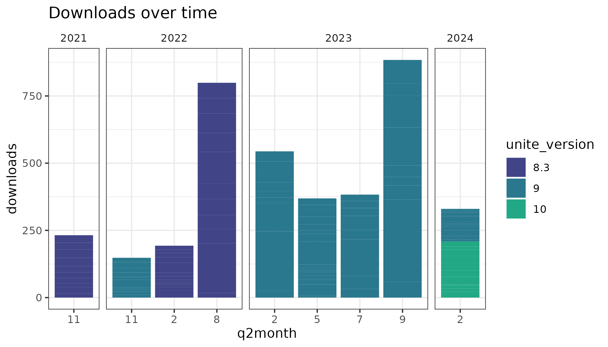
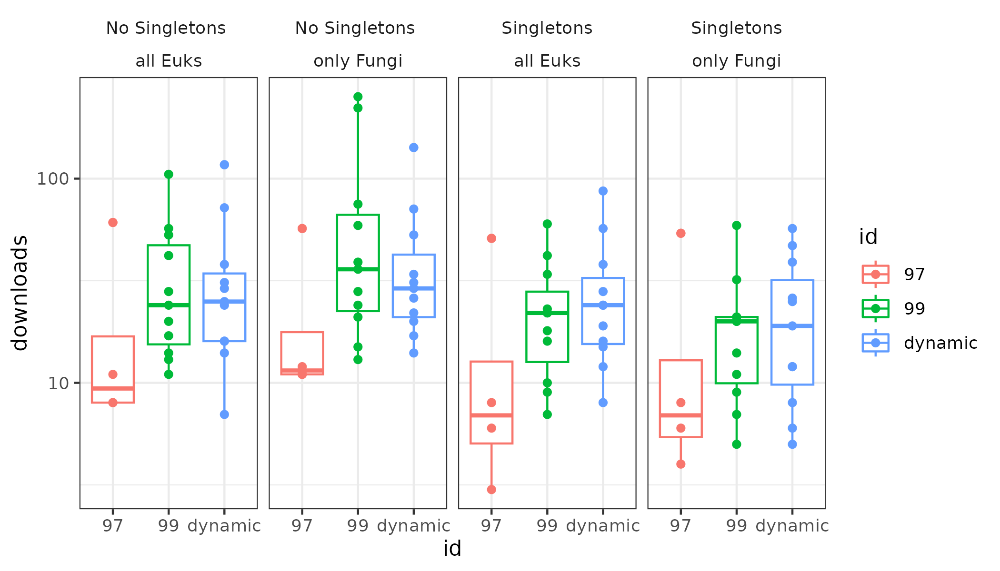

# unite-train

A pipeline to build [Qiime2](https://qiime2.org/) taxonomy [classifiers](https://library.qiime2.org/data-resources) for the [UNITE database](https://unite.ut.ee/repository.php).

## [Download a pre-trained classifier here! 🎁](https://github.com/colinbrislawn/unite-train/releases)

[](https://github.com/colinbrislawn/unite-train/issues)
[](https://github.com/colinbrislawn/unite-train/releases)
[](https://github.com/colinbrislawn/unite-train/releases)

### What is this?

If you are interested in Fungi 🍄 you could use their genomic fingerprint 🧬 to identify them. Affordable PCR amplification and sequencing of the ITS gene gives you these nucleic acid fingerprints, and the UNITE team provides a database to gives these sequences a name.

We can predict the taxonomy of our fungal fingerprints using an old-school machine learning method: a supervised [k-mer](https://en.wikipedia.org/wiki/K-mer) [nb-classifier](https://scikit-learn.org/stable/modules/naive_bayes.html). But first, we need to prepare our database in a process called 'training.'

This is a pipeline that trains the UNITE ITS taxonomy database for use with Qiime2. You can run this pipeline yourself, but you don't have to! I've provided a [ready to use pre-trained classifiers](https://github.com/colinbrislawn/unite-train/releases) so you can simply run [`qiime feature-classifier classify-sklearn`](https://amplicon-docs.qiime2.org/en/stable/references/plugins/feature-classifier.html).

If you have questions about using Qiime2, ask on [the Qiime2 forums](https://forum.qiime2.org/).

If you have questions about the UNITE ITS database, [contact the UNITE team](https://unite.ut.ee/contact.php).

If you have questions about this pipeline, please [open a new issue](https://github.com/colinbrislawn/unite-train/issues/new)!

---

## Running Nextflow Workflow

Set up:

- Install [Pixi](https://pixi.prefix.dev/latest/installation/)

Install Nextflow (26.04 or newer) into the global env

```sh
pixi global install  -c conda-forge -c bioconda nextflow openjdk=17
```

### Apple container (default)

Qiime2 runs from the official [qiime2-workshop:2026.10](https://quay.io/qiime2/qiime2-workshop:2026.10) image using [Apple container](https://docs.seqera.io/nextflow/container/apple-container), so we get memory stats on macOS ([#20](https://github.com/colinbrislawn/unite-train/issues/20)). Needs Apple silicon.

- Install [Apple container](https://github.com/apple/container/releases)

```sh
container system start
# Optional: pull the image ahead of time (~8 GB)
container image pull --platform linux/amd64 quay.io/qiime2/qiime2-workshop:2026.10
container run --rm --rosetta --platform linux/amd64 quay.io/qiime2/qiime2-workshop:2026.10 qiime info
```

To update Qiime2, change `qiime2_version` in `nextflow.config`, and update pixi to match (below): fits too big for a VM (the large eukaryote ones) run natively with pixi.

### Pixi (alternative)

Run with `-profile pixi` to use the locked version of Qiime I commited to the repo instead.

```sh
pixi install
```

```sh
# How to reset pixi, say when updating to a new version of Qiime2
rm pixi.toml pixi.lock rachis-qiime2-osx-64-conda.yml
rm -rf .pixi/

# Get new qiime distribution
wget https://raw.githubusercontent.com/qiime2/distributions/refs/heads/dev/2026.10/qiime2/released/rachis-qiime2-osx-64-conda.yml
# Import from the conda env
pixi init --platform osx-64 --import rachis-qiime2-osx-64-conda.yml
# Install
pixi run qiime info

# Add it directly to the repo?
git add pixi* rachis-qiime2-osx-64-conda.yml
```

## Configure & Run:

```sh
# Reports, timeline and trace save to ./results/
export NXF_OFFLINE=TRUE
nextflow run main.nf -resume
# or, with pixi
nextflow run main.nf -resume -profile pixi
```

## Downloads




